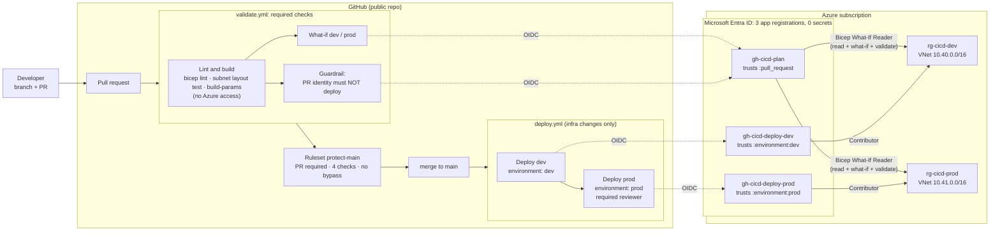

# Azure Bicep CI/CD Pipeline

GitHub Actions pipeline for Bicep infrastructure: **lint, type checks, and what-if on every pull request**, **deploy to dev on merge**, **deploy to prod after a human approval**, and a **post-deploy idempotency check** in every environment. Azure sign-in uses OIDC (workload identity federation): **no stored secrets**, and three least-privilege identities separate *previewing* a change from *making* it.

Built as a hands-on project while studying for **AZ-104: Microsoft Azure Administrator**. This is lab work in a personal subscription, not a production environment. Every result below comes from real runs, with sanitized evidence in [`docs/evidence/`](docs/evidence/).

> **Status:** complete (M0–M5). Root-cause reports: [RCA-001](docs/rca/rca-001-oidc-subject-mismatch.md) · [RCA-002](docs/rca/rca-002-deploy-not-idempotent.md) · [RCA-003](docs/rca/rca-003-deploy-failure-after-passing-checks.md). Interview notes: [`docs/interview-guide.md`](docs/interview-guide.md).

## Problem It Solves

In [Project 2](https://github.com/ChefBoyRJeff/azure-monitoring-incident-response), an NSG rule deleted by hand in the portal broke SSH, and the alert built to catch it missed it ([RCA-001 there](https://github.com/ChefBoyRJeff/azure-monitoring-incident-response/blob/main/docs/rca/rca-001-nsg-rule-deleted-ssh-outage.md)). Detection helps; the stronger control is **making every change go through review and an automated pipeline**, so that:

- every proposed change is **validated and previewed** before anyone approves it,
- approved changes deploy **the same way every time**, dev first, prod only after a person approves,
- the pipeline holds **no long-lived credentials**, and each stage can do **only what it needs**.

## Architecture



### Identities and access

| Identity | Federated credential subject (immutable format) | Role @ scope | Can change resources? |
|---|---|---|---|
| `gh-cicd-plan` | `repo:ChefBoyRJeff@156028335/azure-bicep-cicd-pipeline@1435132927:pull_request` | Custom **Bicep What-If Reader** @ both RGs | **No** (proven by the Guardrail check on every PR) |
| `gh-cicd-deploy-dev` | `…@1435132927:environment:dev` | Contributor @ `rg-cicd-dev` | Dev only |
| `gh-cicd-deploy-prod` | `…@1435132927:environment:prod` | Contributor @ `rg-cicd-prod` | Prod only, after approval |

**How sign-in works:** a job asks GitHub for a short-lived signed OIDC token whose *subject* names this repository and the trigger (pull request or environment). Microsoft Entra ID accepts it only if issuer, audience, and subject **exactly** match the identity's federated credential, then issues an Azure access token valid for about an hour. Nothing long-lived exists that could leak. A fork, another repository, or a different trigger produces a different subject and is refused.

### Workload

A deliberately small, **free** network per environment. The subject of this project is the pipeline, not the workload.

| Resource | dev (`rg-cicd-dev`) | prod (`rg-cicd-prod`) |
|---|---|---|
| VNet | `vnet-dev` 10.40.0.0/16 | `vnet-prod` 10.41.0.0/16 |
| Subnets | `snet-app` 10.40.1.0/24, `snet-data` 10.40.2.0/24 | `snet-app` 10.41.1.0/24, `snet-data` 10.41.2.0/24 |
| NSGs (one per subnet) | app: HTTPS from VNet; data: SQL 1433 from the app subnet only; both deny other VNet traffic | same |
| Route table | `Drop-Blocked-Range`: 10.99.0.0/16 → None | same |

The address ranges don't overlap the other portfolio labs (10.0–10.2, 10.20–10.21), so they could be peered later.

## The Controls, and the Evidence for Each

| Control | How it works | Proven by |
|---|---|---|
| **Lint as errors** | `bicepconfig.json` raises 12 linter rules to `error`; user-defined types reject bad parameter shapes (e.g. NSG priority 5000) | `m0-01`; M4a: an unused parameter blocked the PR (`m4a-01`, `m4a-02`) |
| **Subnet layout test** | `scripts/Test-SubnetLayout.ps1`: subnets inside the VNet, no overlaps, no host bits. No Azure access | `m4-03` (PASS on real files; FAIL on the replayed M4b error) |
| **What-if on every PR** | Read-only identity, `--validation-level ProviderNoRbac`; output in the run summary | `m2-03`: "4 to create" per environment before anything existed |
| **Guardrail** | The PR identity attempts a real deployment; the check **passes only** if Azure refuses `Microsoft.Resources/deployments/write` | `m2-03`, and every PR since |
| **Branch protection** | Ruleset: PR required, 4 required checks, no force push, no bypass | `m2-04`: direct push rejected with `GH013` |
| **Environments** | Per-environment secret and OIDC subject; deployments from `main` only; admin bypass off; prod requires approval | Run #2 (`m3-03`): prod waited for approval |
| **Dev before prod** | `deploy prod` `needs: deploy dev` | Runs #1 and #3: dev failed, prod **skipped** |
| **Idempotency check** | After deploying, what-if runs again; anything other than `NoChange`/`Ignore` fails the job | RCA-002: caught real what-if noise; `m3-03`, `m4-04`: PASS |
| **Root cause in the log** | On deploy failure, the failed nested operation is printed (redacted) | Added after RCA-003 |
| **No IDs in public logs** | Secrets are masked by GitHub; every other GUID is redacted by the workflow | Added after RCA-001 (object ID leak) |

## Failures and Root-Cause Reports

Two failures were **real** (found by the pipeline's own checks during the build); two were **controlled** exercises.

| Report | Type | What happened | Fix |
|---|---|---|---|
| [RCA-001](docs/rca/rca-001-oidc-subject-mismatch.md) | Real | First PR run: `AADSTS700213`. GitHub sends **immutable** OIDC subjects (`owner@id/repo@id`) for repositories created after 2026-07-15; the federated credentials used the old name-based format | Setup script now builds immutable subjects and **reconciles** (removes stale credentials) |
| [RCA-002](docs/rca/rca-002-deploy-not-idempotent.md) | Real | First deployment **succeeded** but the idempotency check failed: what-if reported `- privateEndpointVNetPolicies` (an Azure default missing from the code) | Declared the default explicitly, so no filter or exception was needed. Prod never deployed until it was fixed |
| [RCA-003](docs/rca/rca-003-deploy-failure-after-passing-checks.md) | Controlled | **M4a:** lint error, PR blocked. **M4b:** overlapping subnet passed lint, types, *and* what-if, then failed at deploy with `NetcfgSubnetRangesOverlap`. Dev unchanged (atomic rejection), prod skipped | Recovered with a **revert PR**; prevented by the subnet layout test in the required Lint check |

## Findings

Things learned from real behavior, each backed by evidence:

1. **What-if needs deployment permissions by default.** Built-in Reader can't run it. A custom role (`*/read` + `deployments/whatIf/action` + `deployments/validate/action`) works **with `--validation-level ProviderNoRbac`** (M2).
2. **GitHub's immutable OIDC subjects** are the default for repositories created after 2026-07-15. Documentation examples still show the name-based format (RCA-001).
3. **New federated credentials take about a minute to replicate**: one matrix job failed while its siblings, seconds later, succeeded (RCA-001).
4. **The deploy refusal for a read-only identity arrives during preflight** as `InvalidTemplateDeployment` ("Authorization failed for template resource … `deployments/write`"), not the code `AuthorizationFailed` (RCA-001).
5. **Error messages leak IDs that GitHub doesn't mask** (object ID, correlation ID). In a public repo, redact everything you print.
6. **What-if reports provider-set defaults as removals.** Declare them in code (RCA-002).
7. **What-if doesn't catch subnet overlap.** The network provider only rejects it on the actual write, and rejects the whole VNet update (RCA-003).
8. **A skipped required check counts as passed** in GitHub rulesets; the first job in a `needs` chain must itself be required. A skipped matrix job is never expanded, so its required checks stay "expected", which fails closed (RCA-003).
9. **A negative test must fail for the intended reason.** PowerShell `-replace` is case-insensitive and corrupted an unrelated property; the test "failed" on a type error instead. Use `-creplace`, and read the failure text (RCA-003).
10. On Windows, `az` is `az.cmd`: arguments containing `(`, `)`, or `&` break cmd.exe parsing. Count and filter in PowerShell instead (M1).
11. `az -o table` silently drops a column named `type`; `no-hardcoded-location` flags resource `location` literals but not parameter defaults.

## Repository Structure

```
├── .github/
│   ├── workflows/
│   │   ├── validate.yml           # PR: lint + subnet test + build → what-if dev/prod + guardrail
│   │   └── deploy.yml             # main (infra changes): dev → approval → prod
│   └── actions/deploy-env/
│       └── action.yml             # shared deploy steps: what-if → deploy → verify → idempotency check
├── bicepconfig.json               # linter rules raised to error
├── infra/
│   ├── main.bicep                 # resource-group scope entry point
│   ├── types.bicep                # user-defined types (NSG rule, subnet)
│   ├── modules/{vnet,nsg}.bicep
│   └── params/{dev,prod}.bicepparam
├── identity/
│   └── bicep-whatif-reader.role.json   # custom role definition ({subscriptionId} placeholder)
├── scripts/
│   ├── Initialize-PipelineIdentity.ps1 # idempotent setup: RGs, role, apps, federated credentials, assignments
│   └── Test-SubnetLayout.ps1           # pre-merge CIDR check (local and CI)
└── docs/
    ├── plan.md · interview-guide.md
    ├── rca/                        # RCA-001..003
    └── evidence/                   # sanitized output per milestone (m0-…m4-)
```

## Set It Up From Scratch

**Prerequisites:** an Azure subscription where you hold **Owner** (or User Access Administrator, to create the custom role and role assignments), Azure CLI 2.76+ with Bicep, PowerShell 7, Git, and a GitHub repository.

1. **Azure and Entra ID setup.** Edit the defaults at the top of `scripts/Initialize-PipelineIdentity.ps1` (`-Repo`, `-OwnerId`, `-RepoId`; the IDs are shown in the `azure/login` log of any run as the *subject claim*). Then run each step and read its output:
   ```powershell
   .\scripts\Initialize-PipelineIdentity.ps1 -Step 1 -OutFile setup-1.txt   # resource groups
   # … steps 2–5: custom role, app registrations, federated credentials, role assignments
   .\scripts\Initialize-PipelineIdentity.ps1 -Step 6 -OutFile setup-6.txt   # verify (read-only)
   ```
   The script is idempotent: re-running creates nothing new (`m1-07`).
2. **GitHub secrets.** Repository secrets: `AZURE_TENANT_ID`, `AZURE_SUBSCRIPTION_ID`, `AZURE_CLIENT_ID_PLAN`. Copy each value with `… | Set-Clipboard` so it never appears on screen.
3. **GitHub environments.** `dev` and `prod`, each with deployment branches limited to `main`, admin bypass **off**, and an environment secret `AZURE_CLIENT_ID` (that environment's deploy identity). `prod` also gets **required reviewers**.
4. **Ruleset** on the default branch: require a pull request, require the 4 status checks (`Lint and build`, `What-if (dev)`, `What-if (prod)`, `Guardrail - plan identity cannot deploy`), block force pushes and deletions, empty bypass list. The checks can only be selected after they've run once.
5. Open a PR. After the checks pass and it merges, dev deploys and prod waits for approval.

**Validate locally before pushing** (same rules as CI):

```powershell
az bicep lint --file infra\main.bicep
.\scripts\Test-SubnetLayout.ps1 -ParamFile infra\params\dev.bicepparam, infra\params\prod.bicepparam
az deployment group what-if -g rg-cicd-dev -f infra\main.bicep -p infra\params\dev.bicepparam
```

## Security

- **No secrets anywhere.** Verified with `az ad app credential list`: 0 secrets and 0 certificates on all three apps (`m1-06`, `m2-02`).
- **Least privilege:** no pipeline identity has a subscription-scope role; the PR identity can't write, and dev can't touch prod.
- **Public repository hygiene:** IDs stored as GitHub secrets (masked); all other GUIDs redacted by the workflow; evidence scanned for GUIDs and emails before every commit; deletion of the one run log that leaked an object ID was requested (RCA-001).
- **Forks:** workflows triggered by pull requests from forks don't receive the repository's secrets, and their token permissions are read-only, so outside contributors can't sign in to Azure as these identities.
- **Actions pinned** to current major versions (`actions/checkout@v6`, `azure/login@v3`, Node 24); Bicep pinned to v0.48.1 so CI matches local results.

## Cost

| Item | Cost |
|---|---|
| VNets, subnets, NSGs, route tables | **$0** (Microsoft Learn: "There's no charge for using Azure Virtual Network") |
| App registrations, custom role, role assignments | $0 |
| GitHub Actions on a public repository | $0 |
| **Total** | **$0/month.** Both environments can stay deployed for demos |

## Teardown

Nothing here costs money, so the environments are kept for demos. To remove everything, run these **in order** (a custom role can't be deleted while it's still assigned). This sequence hasn't been run yet, so check each step's output before the next.

```powershell
$sub  = az account show --query id -o tsv
$plan = az ad sp list --display-name gh-cicd-plan --query "[0].id" -o tsv

# 1. Remove the custom role's assignments, then the role (its assignable scopes are the two resource groups)
foreach ($rg in 'rg-cicd-dev', 'rg-cicd-prod') {
  az role assignment delete --assignee $plan --role "Bicep What-If Reader" --scope "/subscriptions/$sub/resourceGroups/$rg"
}
az role definition delete --name "Bicep What-If Reader" --scope "/subscriptions/$sub/resourceGroups/rg-cicd-dev"

# 2. Resources (also removes the Contributor assignments scoped to these groups)
az group delete -n rg-cicd-dev --yes
az group delete -n rg-cicd-prod --yes

# 3. Identities (also removes their service principals and federated credentials)
foreach ($name in 'gh-cicd-plan', 'gh-cicd-deploy-dev', 'gh-cicd-deploy-prod') {
  $appId = az ad app list --display-name $name --query "[0].appId" -o tsv
  if ($appId) { az ad app delete --id $appId }
}
```

Then, in GitHub, optionally delete the `dev` and `prod` environments and the repository secrets. Without the identities, the workflows fail harmlessly at sign-in.

## Known Limitations and Improvements

| Limitation | Production approach |
|---|---|
| Dev and prod share **one subscription** | Separate subscriptions (or management groups) per environment, with Azure Policy |
| One person writes, merges, and approves (self-approval allowed) | Separate reviewers; "prevent self-review" on the prod environment |
| What-if appears in the run summary, not as a PR comment | Post it as a PR comment (needs `pull-requests: write`) |
| Actions pinned by major tag | Pin to commit SHAs and update them with Dependabot |
| **No scheduled drift detection.** A manual portal change is only noticed at the next deploy | A nightly workflow running what-if against both environments that alerts on any difference. It would have caught Project 2's incident |
| Pre-merge tests cover subnet layout only | Add NSG rule checks (unique priorities, prefixes inside their subnet) |
| What-if noise handled by declaring defaults | Evaluate deployment stacks what-if (Microsoft's lower-noise option) |
| Workload is network-only | The same pipeline pattern applies to any resource-group-scoped Bicep |

## AZ-104 Skills Demonstrated

| Objective | Where |
|---|---|
| Manage Microsoft Entra identities: app registrations, service principals | M1 setup script; federated credentials |
| Manage access to Azure resources: built-in and custom roles, scopes, interpreting assignments | Custom What-If Reader role; RG-scoped Contributor; 403 guardrail |
| Automate deployment of resources with ARM templates or Bicep: interpret, modify, deploy | Modules, user-defined types, `.bicepparam`, what-if, deployment operations |
| Configure virtual networks, subnets, NSGs, route tables | The workload; RCA-003 (subnet overlap) |
| Manage resource groups and resource deployment history | Per-environment RGs; nested deployment diagnosis |

CI/CD itself isn't an AZ-104 objective. It's here because Azure administrator and cloud engineer roles increasingly expect it.
